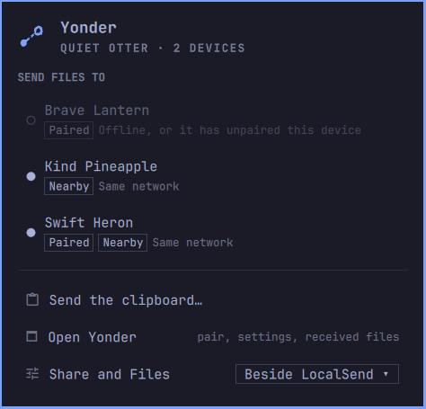

# Yonder for Omarchy

A bar icon and panel for [Yonder](https://getyonder.org) in [Omarchy](https://omarchy.org)'s shell. The panel lists the devices Yonder can send to, paired ones anywhere and nearby ones on your network (LocalSend devices among them), and sends files or the clipboard to one. If you want, Yonder also shows in Omarchy's Share menu and in Files, beside LocalSend or in its place.



## What it needs

- **Omarchy** with shell plugins (written and tried on Omarchy 4.0.6).
- **Yonder 0.1.8 or newer**, as the command `yonder` on your `PATH`. The plugin does not install Yonder. Download it from <https://getyonder.org>, unpack it and run its `install.sh`, which puts `yonder` in `~/.local/bin`. With an older Yonder the panel says so and does nothing else.
- For "Send the clipboard": `wl-paste` (package `wl-clipboard`).
- For the action in Files: Files (Nautilus) with `nautilus-python`.

Omarchy has the last two already. The plugin holds no installer and asks for no password. It uses no network itself and reads none of Yonder's files: everything goes through the `yonder` command (`yonder devices -json -app`, `yonder send -id`).

## Install

```sh
omarchy plugin add https://github.com/getyonder/omarchy-yonder --enable
```

The icon goes in the right section of the bar. Press it to open the panel:

- Press a device to choose files and send them to it.
- "Send the clipboard…" sends the clipboard's text as a file.
- "Open Yonder" opens the app's window, for pairing, settings and received files.

Receiving stays with the Yonder app: its own notification and window ask you to accept.

## Share and Files

The first time the panel opens it asks once where else Yonder is to show. You can change the answer at any time under "Share and Files" in the panel. Until you choose, the plugin writes nothing outside its own folder.

| Setting | Omarchy's menu, under Share | Files, right click |
| --- | --- | --- |
| Off | nothing changes | nothing changes |
| Beside LocalSend | one new row, "Send with Yonder" | one new action, "Send with Yonder" |
| In place of LocalSend | Clipboard, File, Folder and Receive use Yonder | "Send with Yonder" only; "Send via LocalSend" is put aside |

Each of these opens the panel with what is to be sent; press a device there to send it. Yonder sends files only, so a folder is sent as the files in it, without their folders.

The terminal command `omarchy share` always uses LocalSend, because that script is Omarchy's own.

Files reads its actions only when it starts. After a change, close its windows or run `nautilus -q`; the panel tells you when this is needed.

### What the setting changes

The helper script `share` in the plugin's folder makes the changes. It touches two places, and only when you change the setting:

1. **Your menu file**, `~/.config/omarchy/extensions/omarchy-menu.jsonc`. It adds one block of lines straight after the opening `{`, between the marks `// >>> org.getyonder.yonder` and `// <<< org.getyonder.yonder`. No other line is changed, so your own rows and comments stay. If the file does not exist it is made. If the file does not start with a line that holds only `{`, or if the marks are damaged, the helper changes nothing and says so.
2. **Your Files extensions folder**, `~/.local/share/nautilus-python/extensions/`. It copies the action there as `yonder_send.py`. For "In place of LocalSend" it also renames `localsend.py` to `localsend.py.yonder-aside`, in the same folder.

While it hands files to the panel, the helper also keeps a short list in `$XDG_RUNTIME_DIR/org.getyonder.yonder.send`, and the clipboard's text in a folder `$XDG_RUNTIME_DIR/yonder-clipboard.*`. Both can be read only by you and are removed when the panel has taken them.

### How to undo it

Choose **Off** under "Share and Files" in the panel. This takes the block out of the menu file (and removes the file if the helper made it and nothing else is in it), removes `yonder_send.py` and its compiled copy, and gives `localsend.py` its name back.

The same from a terminal, also without the panel:

```sh
bash ~/.config/omarchy/plugins/org.getyonder.yonder/share remove
```

`share status` prints which of the three the menu file holds now.

By hand, if the plugin's folder is gone: delete the lines from `// >>> org.getyonder.yonder` to `// <<< org.getyonder.yonder` in the menu file, delete `yonder_send.py` in the Files extensions folder, and rename `localsend.py.yonder-aside` there back to `localsend.py`.

## Remove

Choose **Off** under "Share and Files" first. Then:

```sh
omarchy plugin remove org.getyonder.yonder
```

Omarchy runs nothing of a plugin when it removes it, so what the setting wrote is made to cope if you forget "Off":

- The menu rows look for the plugin. Without it, "Send with Yonder" is hidden, and Clipboard, File, Folder and Receive use LocalSend again.
- The first right click in Files after the removal puts the rest right: it takes the block out of the menu file, gives `localsend.py` its name back and removes `yonder_send.py`. "Send via LocalSend" shows again after Files is started again (`nautilus -q`).
- If you never right click in Files, the block stays in the menu file. It does no harm; remove it by hand as above.

`omarchy plugin remove` keeps a copy of the plugin's folder beside it, `~/.config/omarchy/plugins/.org.getyonder.yonder.bak.<time>`. Delete it when you do not want it.

Removing the plugin does not remove Yonder or anything in `~/.config/yonder`.

## Two icons

While Yonder runs, its own tray icon shows in the bar's tray as well as the plugin's icon. To hide one:

- **The tray icon:** right click the tray's arrow in the bar and press "Hide" beside Yonder. Yonder keeps running and receiving.
- **The plugin's icon:** `omarchy plugin disable org.getyonder.yonder` (`enable` brings it back). Choose "Off" under "Share and Files" first: the Share rows and the Files action open the panel, and without the icon in the bar there is no panel to open.

## Settings

"Share and Files" is the only setting, and the panel changes it. For a Yonder that is not on the `PATH`, give the widget's entry in `~/.config/omarchy/shell.json` a `command` list, then run `omarchy-restart-shell`:

```json
{ "id": "org.getyonder.yonder", "command": ["/path/to/yonder"] }
```

## Not in this version

- No badge or accept button for incoming files, and no progress of a transfer: the Yonder app shows these.
- No pairing in the panel: "Open Yonder" leads to it.
- Flatpak installs of Files or of Yonder are not considered.

## Tests

```sh
tests/run
```

Needs `node` and `python3`. The tests run in temporary folders with stand-in commands and never touch your own menu file or Files extensions. Where `omarchy` is installed, the folder is also checked with `omarchy plugin validate`.

## Licence

Apache-2.0; see [LICENSE](LICENSE) and [NOTICE](NOTICE). Yonder is not affiliated with Omarchy or with LocalSend.
